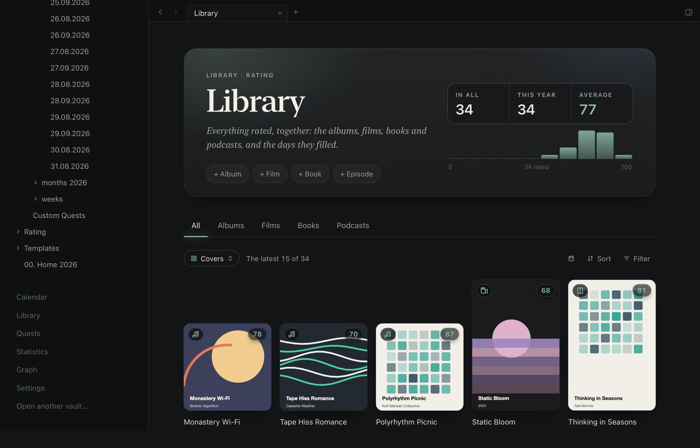

<p align="center"></p>

# Epizen

A calm, macOS-first Markdown workspace for knowledge work and agentic workflows. Open an
Obsidian-compatible vault, write and connect ideas, then enable only the workflows you want.
Built with Tauri 2, Rust, React and TypeScript.

[Download the latest release](https://github.com/botsiti/epiZen/releases/latest) ·
[Changelog](CHANGELOG.md) · [Release process](RELEASING.md)

## What you can do

- **Write and connect notes.** Frontmatter, wikilinks, embeds, callouts, tasks, highlights and a live
  Markdown preview. Tabs, history, backlinks and graphs keep navigation close at hand.
- **Manage files safely.** Rename from the title with automatic incoming-link updates, duplicate,
  reveal in Finder, or move a note to recoverable trash from the sidebar. Saves check for external
  edits, and failed saves preserve your text.
- **Choose your plugins.** New vaults start with Markdown. Enable Homepage, epiBase, Library,
  Periodic notes, Habits, CBT, check-ins and planning tools in Settings → Plugins. Existing users
  keep their workflows on upgrade; plugin choices belong to each vault.
- **Use your Obsidian Bases with epiBase.** Open or import `.base` files and embed named views in notes.
  Configure tables, cards and lists with properties, nested filters, sorting, grouping, formulas
  and summaries. Edits remain ordinary YAML and Markdown with conflict-checked saves.
- **Make the workspace your own.** Dedicated settings pages for periodic notes, Homepage,
  files and Hotkeys. Preview existing daily notes before connecting them, choose library lookup
  sources, and set default locations for new notes and folders.
- **Keep Home focused.** A compact overview of your day, life spheres, eight quests at a time and
  ten recent library entries, with dedicated views for the full collections.
- **Review your year.** Open Summaries from Home to see each month's reflection and daily averages.
  Monthly pages include money notes, optional local photos, life-area ratings and weekly reflections.
- **Review quests and statistics.** Browse quests by month, track progress and XP, inspect daily
  focus by task and category, and see habit completion as proportionally filled monthly bars.
- **Bring your own notes.** Open a vault directly. When you enable Periodic notes, its settings
  connect existing folders, recognize older names and resolve duplicate dates without renaming notes.
- **Choose your check-ins.** Enable or hide mood, energy, focus, social and sleep. Averages count
  only recorded days; a month without a metric omits it. Disabling CBT removes its daily tab.
- **Build your library.** Albums, films, books, podcast episodes and videos, with covers, ratings,
  metadata, filters and a calendar view. Mixed shelves identify each kind with a small cover badge.
  Add notes, find covers, suggest existing genres, and keep favorite album tracks and thoughts.
- **Plan and focus.** Built-in daily, weekly and monthly pages, local Apple Calendar integration,
  and a focus timer with a menu-bar panel. Logged time stays in your daily notes.
- **Talk to Spike.** An animated desktop companion opens a conversation beside your notes.
  Type or record a voice message to add library entries, create or edit notes, capture links, schedule
  calendar events, or work through a thought record saved in today's note. Spike can recall
  relevant past conversations and preferences you choose to keep in an editable profile note.
  Proposed changes can be reviewed or applied automatically when you enable that preference.



## Your vault stays yours

Notes remain plain Obsidian-compatible Markdown. There is no app-managed account, database,
sync or execution of Obsidian plugins. Settings and conversation history live outside the vault.
Network requests are limited to library lookups and optional assistant requests you trigger;
calendar access uses local EventKit. Spike can use the installed Codex CLI with your existing
ChatGPT subscription, or an OpenAI API key stored in macOS Keychain. Choose the connection in
Spike's settings. For a subscription, install Codex CLI and run `codex login` once; normal plan
limits apply. Messages and relevant context are sent through the selected provider when used.
Codex owns its login; Epizen does not read or copy its tokens. Subscription voice uses macOS
on-device speech recognition and the system voice, with permission and an installed language.

Open Spike from the tab bar, then use its settings to connect the AI service, choose a profile
note, and enable the desktop companion. The companion can be shown before connecting an AI
account. Conversation history is scoped to the vault, and Export creates an ordinary Markdown
transcript, including unsent text and unresolved changes, without replacing an existing file.

Every plugin row has Configure. Display preferences belong to the vault: compact or comfortable
layout, the initial daily tab, habit collection, calendar view and statistics range, plus optional
progress, activity and history sections. Existing folder, template and source setup is reachable
from the same panels. Disabling a plugin retains its choices and leaves Markdown untouched.

## Install

Download the macOS Apple Silicon ZIP from [Releases](https://github.com/botsiti/epiZen/releases),
unzip it and move `Epizen.app` to Applications. The current releases are ad-hoc signed, not Apple
Developer ID notarized. Each release includes its compatibility and validation notes plus a SHA-256 checksum.

## Develop and verify

Use the Node version in `.nvmrc` and the Rust toolchain in `rust-toolchain.toml`.
Try it on a temporary copy of the demo vault:

```sh
npm ci
EPIZEN_DEMO=$(mktemp -d /tmp/epizen-demo.XXXXXX)
cp -R demo-vault "$EPIZEN_DEMO/vault"
EPIZEN_VAULT="$EPIZEN_DEMO/vault" npm run tauri dev
```

`npm run check:fast` runs the daytime checks; `npm run check` also runs desktop E2E.
[AGENTS.md](AGENTS.md) describes the working agreement, [DESIGN.md](DESIGN.md) the interface,
and [REVIEW.md](REVIEW.md) the review priorities. See [RELEASING.md](RELEASING.md) for versioning,
production builds and GitHub Releases.
