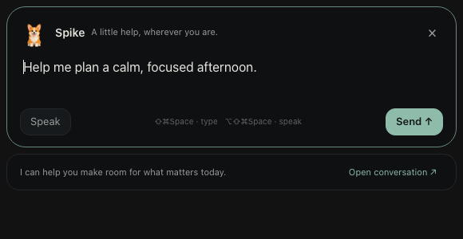

# Epizen features

Epizen is a macOS-first desktop app for an ordinary Obsidian-compatible Markdown vault. Download
its Apple Silicon app from [GitHub Releases](https://github.com/botsiti/epiZen/releases/latest).
See the [README](../README.md) for installation and [release notes](../CHANGELOG.md) for changes.

## Markdown workspace

The core stays available with every optional plugin disabled:

- Read and edit Markdown with frontmatter, wikilinks, embeds, callouts, tasks, highlights and live preview.
- Navigate files and folders, multiple tabs, pinned tabs, tab history, backlinks and outgoing links.
- Create notes and folders in chosen locations. Rename a note and update incoming links, duplicate it,
  reveal it in Finder, or move its Markdown file to recoverable trash.
- Conditional atomic saves detect external edits. Conflicts and failed saves retain recovery text.
- New vaults start with the core; optional workflows are enabled per vault in Settings → Plugins.

## Built-in plugins

| Plugin | What it adds | Where to configure |
| --- | --- | --- |
| Homepage | Profile and XP, memento mori, check-ins, focus, tasks, spheres, quests and recent library | Plugins → Homepage; Homepage settings |
| epiBase | Obsidian `.base` files and embedded table, card and list views | Plugins → epiBase; each base’s toolbar |
| Library | Books, albums, films, podcast episodes and videos with covers, ratings, filters and calendar views | Plugins → Library; Homepage settings for lookup sources/artwork |
| Graph | Interactive note/link graph, search and folder colours | Plugins → Graph |
| Spike | Conversation sidebar, desktop companion, global quick prompt and dictation | Plugins → Spike → Set up Spike |
| Periodic notes | Daily, weekly and monthly pages with calendar navigation | Plugins → Periodic notes; Periodic notes settings |
| Check-ins | Selectable mood, energy, focus, social and sleep fields | Plugins → Check-ins |
| Habits | Persistent routines, archive/reactivation, streaks and history | Plugins → Habits; Habits screen |
| CBT | Thought-record wizard and saved reflection sessions | Plugins → CBT; daily CBT tab |
| Quests | Weekly/monthly/custom goals, progress, XP, deadlines and adventure logs | Plugins → Quests; quest details |
| Statistics | Recorded focus, check-in and habit analysis, plus year summaries | Plugins → Statistics; Statistics and Summaries |
| Calendar | Day/week planning alongside local Apple calendars | Plugins → Calendar; Calendar screen |
| Focus timer | Focus/rest sessions, daily-note logging and menu-bar controls | Plugins → Focus timer; Calendar and menu bar |

Daily-life and planning plugins that depend on Periodic notes pause when it is disabled, retaining
choices and historical Markdown. Disabling a plugin leaves notes untouched. Display preferences
include compact layouts and module-specific starting views or summary sections where available.

## Spike companion, prompts and voice

Choose the assistant connection in Spike settings:

- **ChatGPT subscription through the installed Codex CLI:** uses Codex’s existing login and plan
  limits. Epizen does not extract its tokens or silently switch to API billing. Install Codex and
  run `codex login` before connecting.
- **OpenAI API:** uses a key stored in macOS Keychain; API usage is billed separately.

Show the desktop companion before or after connecting. Drag Spike to move him, pause his animation,
click him or **Text** for the prompt directly below him, or right-click to hide him. ⇧⌘Space brings both back and hides them on a second press. System Reduce Motion is respected.

Use the prompt from other apps, or open the full sidebar with ⌘8. Spike can capture ordinary notes
and links, search relevant notes and past conversations, add library entries with catalogue covers, dates, ratings and comments, remember preferences
in an editable profile note, propose calendar events and save CBT thought records. Proposed changes
show their destination and full text for review unless automatic application was explicitly enabled.
The quick prompt uses the same controller and conditional-write path as the sidebar.

Dictation is independent of the assistant connection. Select **On this Mac**, **OpenAI API** or
**OpenRouter**, enter the transcription model, connect the selected API key if needed, and save voice
settings. API credentials stay in Keychain. Audio is uploaded only when sending voice to the selected
remote provider. Local recognition requires macOS permission and an installed supported language.
A failed transcription retains its recording for retry; closing the prompt stops recording.

Drafts survive hiding the prompt and app restarts. Unsent sidebar and quick-prompt drafts remain
separate. Interrupted turns and failed actions offer recovery without replaying completed writes.
Conversation history belongs to the current vault and lives in app settings; Export creates a new
ordinary Markdown transcript without replacing an existing file. Profile memories remain editable
Markdown in the vault. Closing the main window while Spike is enabled saves and hides it; Quit exits.

## Reviews, planning and collections

Daily pages combine tasks, habits, check-ins, time by category, quests and CBT. Sleep entry accepts
hours and minutes while preserving the compatible decimal-hour note property. Weekly pages include
Plus / Minus / Next reflections and daily rollups. Monthly reviews include reflection, decisions,
spending and optional local photos, a Wheel of Life, weekly reviews and quests. Home Summaries offers
month-by-month reflections and recorded averages, including months without daily notes.

Habit definitions are normal notes with stable identities and tracking periods; completions remain
daily Markdown checkboxes. Archive and reactivate routines, resume or restart a current streak, and
inspect earlier months. Quest details support editing, deadlines, progress and log entries; deletion
requires confirmation. Existing vault scoring remains compatible.

Library entries remain Markdown. Filter by media kind, rating, dates, genres, artist/author and
media-specific fields; sort and paginate cover shelves or use list and calendar layouts. Lookup
sources and podcast artwork are selectable. Failed lookups leave manual entry available.

Bases preserve their YAML and unknown options. Edit views, nested filters, sort priorities, grouping,
properties, labels, formulas, summaries, table widths and card covers. Declarative legacy Dataview
TABLE queries are supported through the same bounded interpreter. JavaScript and Obsidian plugins
are not executed. Unsupported views retain source, remote covers remain offline, and failed edits
retain drafts for recovery.

Calendar access uses local EventKit. Events and time plans link to daily tasks without adding plan
metadata to notes. Focus sessions log time into daily Markdown; failed logs remain recoverable.
Calendar denial, a provider failure or a failed optional screen does not prevent ordinary note editing.

## Keyboard reference

| Shortcut | Action |
| --- | --- |
| ⌘7 / ⌘9 | Left / right workspace sidebar |
| ⌘8 | Spike conversation sidebar |
| ⇧⌘Space | Show/hide Spike and his prompt |
| ⌥⇧⌘Space | Global Spike dictation, start/finish |
| ⌃3 | Collapse all explorer folders |
| ⌘N / ⌘, | New note / Settings |
| ⇧⌘H / ⇧⌘L / ⇧⌘D | Home / Library / today’s daily note |
| ⌘T / ⌘W | New tab / close tab |
| ⌥⌘1–8 / ⌥⌘9 | Select tab 1–8 / last tab |
| ⌃Tab / ⇧⌃Tab | Next / previous tab |
| ⌘[ / ⌘] | Tab history outside text fields |
| Escape | Save and close the quick prompt, retaining it if saving fails |

Workspace commands pause in modal dialogs. Settings → Hotkeys includes a searchable reference.
Global Spike shortcuts are registered only while its plugin is enabled; registration failures are
reported locally and clicking the companion remains available.

## Compatibility and limits

- macOS on Apple Silicon; current archives are ad-hoc signed, not Developer ID notarized.
- Notes remain ordinary Markdown. No app-managed account, sync, database or Obsidian plugin execution.
- Optional API features require the user’s account/model access and may incur provider charges.
- Microphone, local Speech Recognition and Calendar features depend on macOS permissions and support.
- Physical microphone and account-specific paid-provider behaviour cannot be proven by offline tests;
  release notes distinguish automated, native, live and deferred validation.

Spike can open today’s CBT form, add categorized daily tasks, create weekly/monthly quests,
update requested periodic fields, and schedule a full-duration free calendar block from a part
of the day. The normal review/automatic preference applies. Calendar availability is checked
again before a suggested slot is saved. The built-in `SPIKE.MD` and the current vault’s root
`AGENTS.md`/`SPIKE.MD` provide bounded conversation guidance; hidden memory archives stay private.

A saved calendar block opens its date in the calendar. Library cover downloads happen only when a proposed entry is applied. A failed download keeps the proposal available; retries reuse the same saved attachment instead of creating duplicates. The saved entry opens its media page.
