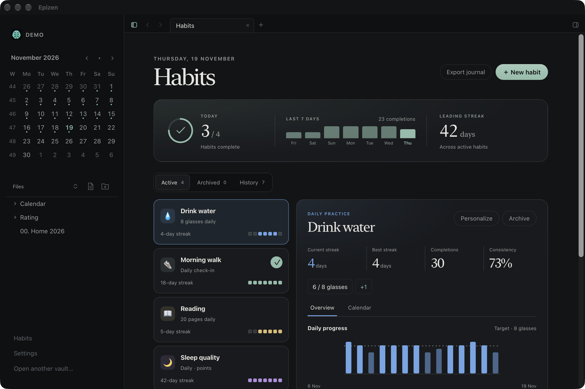

# Habits



Open **Habits** from the sidebar. Add a daily habit with **New habit**, or use **Continue recent
routine** to carry forward the latest habit set found in your daily notes. The History collection
also lets you continue an older habit individually. No existing daily note is rewritten by this step.

Active habits appear in the day's Overview and Habits tab from their start date. Checking one
writes a normal Markdown checkbox to that day's note. The manager and monthly/weekly dashboards
read the same history.

Use **Archive** and choose the first date the habit is no longer needed. It disappears from that
routine; its note, previous completions and best streak remain. Use **Reactivate** to add a new
tracking period. Choose whether to resume the paused streak or start a new current streak. Days
outside tracking periods do not count as missed. Today remains pending until the day ends.

## Markdown format

A habit definition is an ordinary note in `Habits/`, for example:

```yaml
---
type: habit
habit_id: 92ea36f8-example-id
name: No sweets
aliases: []
periods:
  - from: 2026-11-01
    until: 2026-12-01
  - from: 2027-01-01
---
```

`until` is exclusive: December 1 is the first inactive date. A later period can include
`reset: true` to start a fresh current streak. A same-day start/end is an unused, archived period.
The remaining Markdown body belongs to you; schedule edits preserve it.

Daily records use Obsidian-compatible callouts and inline fields:

```markdown
> [!habits]- Habits
> - [x] No sweets [habit::92ea36f8-example-id]
```

Older habit records without IDs are matched by their names and aliases. Do not create another
habit for a return to an old routine: reactivate the existing definition to keep one history.

Choose **Delete** on an active habit to remove its check-ins from the daily notes and move its definition to the vault trash. Confirm the selected habit in the dialog. XP from those check-ins is removed when totals refresh. Use **Archive** to stop a routine and keep its history.
Conflicting IDs, names, malformed schedules and duplicate daily records are reported, rather
than silently edited. If you rename a definition by hand, keep the former name in `aliases`.

## The daily flow

Select a day in the seven-day strip or the habit calendar. Use the round check-in button beside a habit, or log a value in the selected day's detail. Choose **Open daily note** to read that day's Markdown. You can fill earlier days within a habit's tracking periods, including days that have no note yet. Opening the calendar alone creates no files.

Daily-note habit rows show an illustrated icon. Point at a row or focus its control to see the current and record streaks as of that note's date.

## Habit XP

Open **Settings → Habits → XP settings** beside a routine, or use the same button in the Habits workspace. Choose its base XP, life area, and streak leagues. Starting suggestions are 10 XP per check-in, with 1.5× at 7 days, 2× at 20, 2.5× at 30, and 4× at 100. Edit, remove, or add thresholds and preview the XP each league earns.

The higher rate starts on the completion that reaches its threshold. A missed scheduled day breaks the run. A break outside the schedule pauses it unless you choose to reset on reactivation. Filling or undoing a past completion recalculates affected XP, and saving new reward rules applies them to the habit's whole history. Existing habits earn XP once you save their reward settings.

Habit XP counts in daily, weekly, monthly, and life totals. Assign a life area to credit that area's progress in Home. The habit's Markdown definition stores the rules in a `reward` property with `base`, an optional area ID, and `leagues` entries containing `days` and `percent`.

## Check-ins, targets and measurements

Choose **Track by** when creating a habit. A daily check-in records completion with one click. A daily target records progress in your chosen unit, with a +1 shortcut and an editable value. Reaching the target completes the day. A measured habit records a value, including zero. Its trend connects consecutive recorded days. Open **Color and icon** during creation, or choose **Personalize** in Habits or its settings. Search by an object or an activity, such as “bicycle”, “hydration”, or “morning”.

The seven-day strip shows completion rings across routines. Calendar shows each day’s check-in and Overview shows twenty weeks of activity. The fourteen-day goal chart shows progress against the target, while the measured-value chart shows change over time. Recorded values are also available as a text list.

## Export and share

Choose **Export journal** to save or copy a Markdown report. The report includes active, archived and historical routines, tracking periods, recorded values, and dated check-ins. Its source archive includes the original definition notes and the daily habit task fields. Other daily-note sections stay in the vault. Saving creates a new file at the chosen destination.


## Icon artwork

The first nine illustrated icons in `src/components/habits/icons/` were generated with built-in ImageGen from this prompt, then split into 96px transparent assets.

> Use case: stylized-concept. Create a single square sprite sheet for the Epizen desktop habit journal: exactly 3 columns by 3 rows of isolated small habit emblems, equal cell dimensions, icons centered at 1/6, 1/2, 5/6 of each axis with generous transparent gutters. Reading order: sunrise behind a fir tree, crescent moon, teacup with leaf, candle flame, hourglass, open book, simple dumbbell, lotus, new sprout. Refined softly lit enamel pins with subtle bronze rims, distinct muted peach, gold, sage, lavender, and teal colors. Bold readable silhouettes at 32 pixels on dark navy or ivory UI. No circular background tiles, no words, no frames, no grid lines, actual transparent canvas.


Two additional sheets used the built-in ImageGen tool. Each prompt asked for a precise 4 × 4 grid with transparent gutters and sixteen small enamel pins in muted peach, gold, sage, lavender and teal. The wellbeing sheet used a glass of water, running shoe, apple, toothbrush, alarm clock, stretching figure, bicycle, hiking boots, capsule, soup, sugar shield, jump rope, pillow, sunrise, goggles and orange. The second sheet used headphones, paintbrush, guitar, camera, piano, cactus, laundry, broom, notebook, laptop, coins, envelope, chess knight, paw print, linked hearts and compass. The crops are in the same icon folder as the original set.
