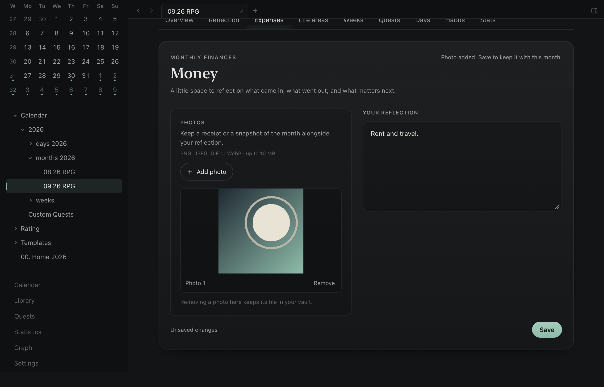

Epizen 0.3.0 makes it easier to review your month, understand your progress, and bring an existing
Markdown vault into the app.

## New and improved

- **A year of summaries:** open Summaries from Home for monthly reflections, focus time, XP and
  daily averages, with a shortcut to each month's note.
- **A monthly review:** write a reflection, keep money notes and optional photos, and rate each
  life area. Existing Obsidian monthly summaries, finance sections and life-area ratings remain
  readable and editable in their existing Markdown format.
- **A simpler money page:** choose local photos without typing image syntax. Photos are copied
  beside the note; removing one from the page leaves its file in the vault.
- **A richer week and quest review:** see weekly hours, mood, sleep and reflections together, plus
  earned, overdue and net quest XP for quests active in the selected month.
- **More useful statistics:** habits count only actual habit callouts, and the focus activity grid
  stays in place while you inspect days.
- **A calmer feel:** faster state feedback, less repeated motion, smoother pointer lighting and
  support for reduced motion.
- **Vault setup and periodic notes:** connect existing folders, recognize older note names, resolve
  duplicate dates, or create a small starter vault without overwriting existing notes.

## Compatibility

Notes remain ordinary Obsidian-compatible Markdown. No accounts, database, app-managed sync or
Obsidian plugin execution are added. The older Obsidian Home dashboard's separate JSON summary
history is not imported; Summaries reads the monthly Markdown notes. Life-area reflections in the
existing Obsidian list format are kept on one line. Quest XP describes current progress on quests
active in the chosen month rather than a dated transaction history.
Photo uploads support PNG, JPEG, GIF and WebP files up to 10 MB; HEIC photos need conversion first.

## Download

`Epizen_0.3.0_macOS_arm64.zip` contains the production app for **macOS on Apple Silicon**.
`SHA256SUMS` contains the archive checksum. The app is **ad-hoc signed and not Apple Developer ID
notarized**; it does not include the test-only WebDriver components.

## Validation

The full local check passed on an isolated copy of the release source: 659 frontend tests, 65 Rust
tests, Clippy, ESLint, TypeScript and all 58 desktop journeys. The demo vault stayed unchanged, and
the changed screens were reviewed. The release workflow checks the integrated revision, reruns the
fast gate and builds the production archive.
