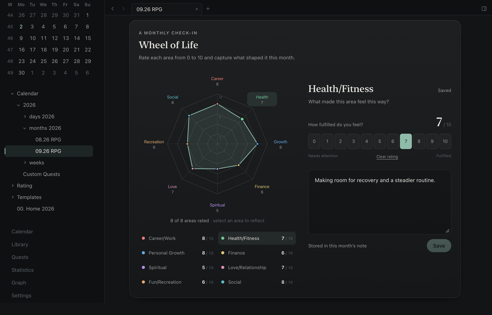

# Epizen 0.4.0

A clearer way to review your month and act on what matters.

## Wheel of Life

Life areas is now **Wheel of Life**: an eight-axis chart with coloured scores, a live outline and
a reflection beside the selected area. Set a score directly with the 0–10 buttons. The wheel eases
into changes without moving the page, and respects reduced motion. Existing ratings and comments
remain compatible with the monthly Markdown notes.

## Decisions and money

**Decisions** has its own monthly tab for choices, reasons and next steps, separate from the
month's reflection. Home Summaries gives those decisions their own column.

The monthly Expenses page now accepts a manually entered **Total spent** and optional currency.
For example, enter `150,000` and `RUB`; Home Summaries shows `150,000 RUB`. Photos and finance
reflections stay alongside that total. Missing totals remain empty rather than appearing as zero.

## Quest controls

Quest details now offer editing for title, description, XP reward, tier and target. The compact
editor keeps Save and Cancel visible. Progress and adventure logs are preserved. Deleting a quest
requires confirmation and removes its log with it. Outside edits and unfamiliar nested content
prevent deletion, and failed edits keep the draft available.

## Compatibility and validation

The new decisions and spending fields are ordinary Markdown sections. No database or migration
is required. Entries that exist only in the older Obsidian Home JSON sidecar are not imported.

The full local gate passed: 667 frontend tests, 65 Rust tests, all 59 desktop journeys, lint,
type checks and fixture integrity. Test windows were shown on the MacBook Pro built-in display.
Wide/narrow visual review and the normal production build passed. A separate motion check verified
eased changes, a fixed layout and immediate updates with motion disabled. The release workflow
checks the merged revision and builds the published production archive.

## Download

The production archive is for **macOS on Apple Silicon**, ad-hoc signed and **not Apple Developer
ID notarized**. It excludes the test-only WebDriver components. Verify the archive with `SHA256SUMS`.
