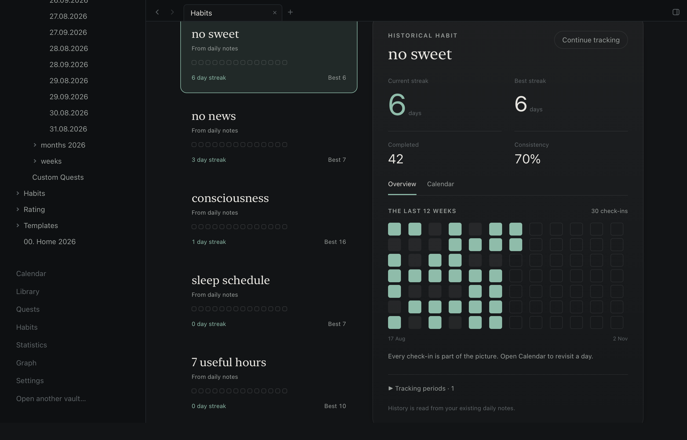

# Epizen 0.5.0

A daily routine that can change without losing its history, with a refined checklist and clearer check-in colours.

## Habits, across months

The sidebar now has a **Habits** screen with Active, Archived and History collections. Create a
daily habit, or continue your most recent habit set from existing daily notes. Older habits can
also be continued individually from History. This is an explicit choice; opening the app does
not modify personal notes.

Direct check-in buttons keep today’s routine within reach. A compact twelve-week history grid, focused editing dialogs and clear streak hierarchy were refined using Productive, HabitKit and (Not Boring) Habits references through Appllama.

Each habit has a calendar, current and best streaks, total completions and consistency. Active
habits appear in daily Overview and Habits, and in weekly/monthly totals even on a date without
a note. Checking a scheduled habit creates its ordinary daily checkbox only when needed.

Archive a habit from a chosen date to take it out of your current routine. Its previous records
stay available. Reactivate the same habit when it fits again; choose whether to resume the paused
streak or start fresh while retaining the previous best. Paused days are not counted as misses.
Today remains a grace day until it is completed or ends.

The definitions are ordinary Markdown notes in `Habits/`. Older daily records connect by name;
new records include a stable habit inline field. No database, automatic migration or plugin
execution is involved. [Format and usage](https://github.com/botsiti/epiZen/blob/v0.5.0/docs/habits.md).

## Check-in colours

Daily check-ins, Home averages, period averages and monthly summaries now share the requested
status colours. Scores on a five-point scale are red below 2.5, yellow from 2.5 to below 3.5, and
green from 3.5 upward. For example, 3.2 is yellow and 3.51 is green. Older ten/hundred-point
scales are normalized to five. Missing values stay faint.

Sleep below 6 or above 9 hours is red, from 6 to below 7 is yellow, and 7 through 9 is green.
Colour decisions use unrounded averages so display rounding does not move a boundary.

## Validation and compatibility

Conditional saves protect outside edits. Duplicate identities, malformed schedules and duplicate
completion records are reported. Archive and resume change only the habit's schedule; daily
history stays in its original notes. The full local gate and production checks are recorded in
the release PR before publication. The full local run passed the frontend and Rust tests
and all 60 desktop journeys; the demo fixture stayed unchanged. Wide/narrow screenshots and
the production app build were reviewed.

The archive is for macOS on Apple Silicon, ad-hoc signed and not Apple Developer ID notarized.
It excludes the test-only WebDriver components. `SHA256SUMS` accompanies the download.
