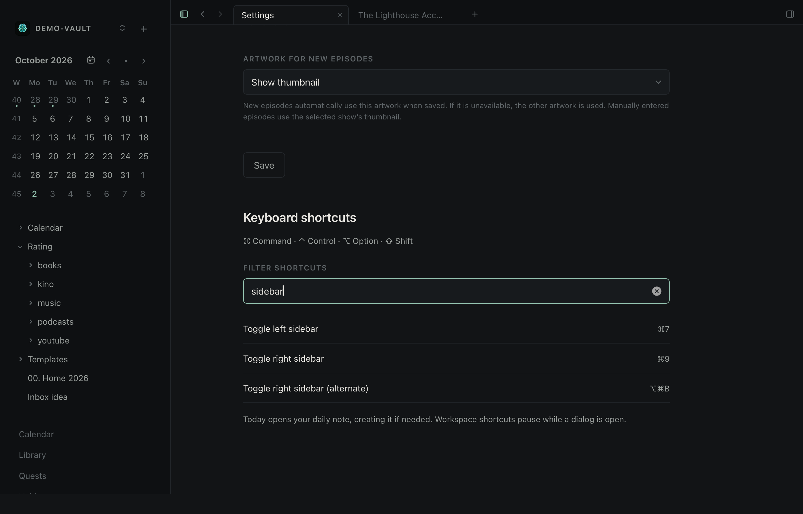
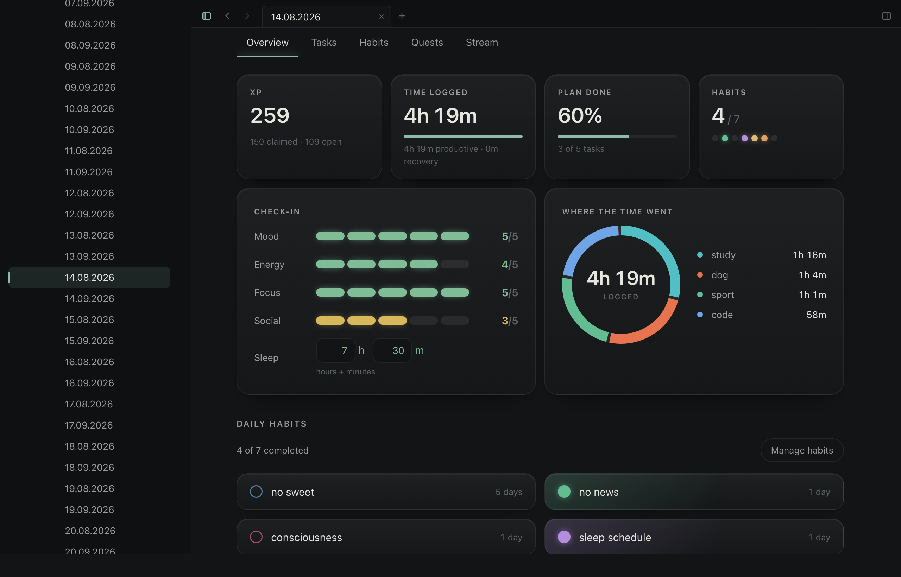

# Epizen 0.6.0

Keyboard shortcuts for the workspace, and sleep entered in hours and minutes.

## Move around from the keyboard

- Control–3 collapses all explorer folders, including nested folders and the current note's ancestors. The note stays open.
- Command–7 toggles the left sidebar; Command–9 toggles the right. Both also have visible switches in the tab bar.
- Command–N opens New note; Command–comma opens Settings.
- Shift–Command–H opens Home, Shift–Command–L opens Library, and Shift–Command–D opens today's daily note, creating it if needed.
- Option–Command–1 through 8 select tabs; Option–Command–9 selects the last tab. Command–7 and Command–9 now belong to the sidebars. Existing tab cycling and the Option–Command–B right-sidebar shortcut remain available.

Settings has a searchable keyboard reference, and the native menu bar lists the new commands.
Workspace commands pause during modal dialogs and preserve text-editing shortcuts. Keyboard
layouts including Cyrillic are supported. Hiding the explorer retains its folder expansion.

## Sleep in hours and minutes

The daily check-in now has separate hours and minutes fields. Enter **7 h 30 m** directly;
the pair saves together on Enter or when focus leaves both fields. Invalid minutes and durations
over 24 hours are rejected. A failed save keeps the entry for retry. Clearing both fields clears
the recorded value; zero remains a recorded duration.

Existing notes continue to work. The ordinary `sleep` property remains decimal hours (`7.5` for
7 h 30 m), so Obsidian and Epizen's averages keep the same meaning. Opening or focusing the fields
does not rewrite the note. There is no migration or new file format.

## Compatibility and validation

The full local gate passed: Rust tests, Clippy, ESLint, TypeScript, all 719 frontend tests and
63 desktop journeys. The demo fixture remained unchanged. Sleep at wide and narrow widths,
sidebar toggles and the keyboard reference were visually checked on the built-in Retina display.
The [release PR](https://github.com/botsiti/epiZen/pull/39) records the checks and screenshots.
Roll back by reinstalling
the previous release or reverting the feature PR; rolling back does not rewrite notes.

This archive is for macOS on Apple Silicon, ad-hoc signed and not Apple Developer ID notarized.
It excludes test-only WebDriver components. `SHA256SUMS` accompanies the download.
